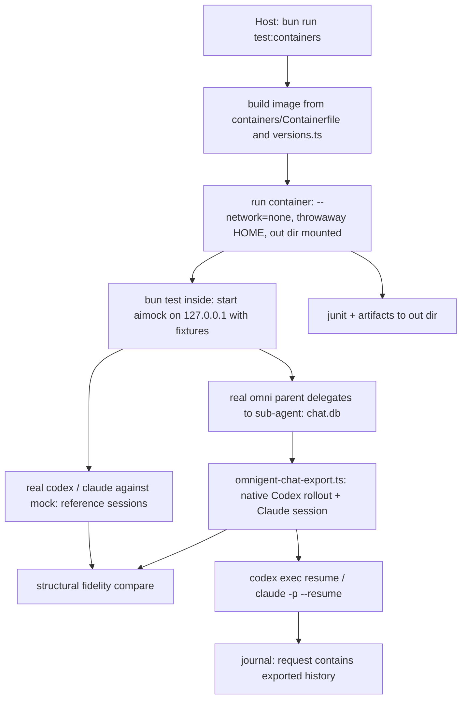

# Hermetic Container Integration Tier for Omnigent Session Export - Plan

**Target repo:** `agent-session-bridge` (fork `andrew-bierman/agent-session-bridge`, base `opencode-native-sync`, work on branch `omnigent-chat-provider`).

## Goal Capsule

- **Objective:** A maintainer, or CI, can run one opt-in command and learn whether the conversations Omnigent creates, including spec-defined sub-agents, come out as native Codex and Claude Code sessions that those tools list and resume with their content intact. The run needs no API keys and cannot touch the user's real tool homes.
- **Means:** Real pinned harness binaries in an offline container, with only the model responses scripted by a mock LLM server (KTD1, KTD2, KTD8).
- **Authority:** Product Contract R-IDs win on behavior, KTDs win on mechanism, units override neither. Settled decisions (KTD2 to KTD6) are not reopened here.
- **Stop conditions:** Stop and report, without weakening an assertion, if (a) the mock cannot drive a real Codex or Claude Code turn after the fallback in KTD1, or (b) real Codex rejects the exporter's rollout in a way no exporter fix resolves.
- **Execution profile:** One pull request. No project instruction requires a per-PR human reviewer or a separately approved path, so no split is justified (Phase 3.3 reasons do not apply). `lfg` implements, reviews, pushes, and watches CI; merging into the fork is pre-authorized by the user for this fork.

---

## Product Contract

### Summary

Add `containers/` plus `bun run test:containers`: one image holds real Omnigent, Codex, Claude Code, and (where feasible) OpenCode and Pi at pinned versions, plus a mock LLM server. Tests run inside the image with no network, drive the real tools through scripted conversations, export Omnigent conversations with `scripts/omnigent-chat-export.ts`, and assert on what the native tools see and replay. The existing unit suite and `bun test` stay fast and container-free.

### Problem Frame

The converters and exporter are covered by unit tests on synthetic data. Four things have never been verified against real binaries: that Codex accepts a rollout the exporter synthesizes, that Codex and Claude Code replay an exported session's history on resume, what Omnigent actually writes for a delegated sub-agent, and that format drift in a new tool release breaks nothing silently. The only real-binary test, `bun run test:real-agents`, spends real tokens on the host. A real Omnigent run is also unsafe on the host: an earlier `omni stop` may have disrupted the user's running Codex agents. A hermetic tier removes cost, flakiness, and host risk together.

### Requirements

**Fidelity of what runs**

- R1. Every tool that creates or consumes a session in a scenario is the real binary at a pinned version; only model responses are scripted.
- R2. One mock server speaks OpenAI Responses and Anthropic Messages, with streaming and tool calls, from versioned fixtures, and journals every request it receives.
- R3. Each scenario asserts, from the journal, that every harness reached the mock, so a harness that silently skipped the model or used a real endpoint fails the test.

**Scenarios**

- R4. An Omnigent parent that delegates to a spec-defined sub-agent exports to native Codex rollouts, indexed in Codex's thread database, and to Claude Code sessions. Message text, tool calls and outputs, order, and working directory match the scripted conversation.
- R5. Resuming an exported Codex or Claude Code session sends its history to the model: the follow-up turn's journaled request contains the exported messages.
- R6. A rollout or session written by the real Codex or Claude Code against the mock is the reference. The exporter's output has the same record types and required fields per type, so a release that changes the format fails a test.
- R7. A session created by Omnigent's native Codex bridge (`omni codex`) is found by the locator, synced, and resumable in Codex, with its sub-agent and parent link metadata agreeing with `chat.db`.
- R8. Re-running an export or sync against the real thread index adds no duplicate and overwrites nothing.
- R9. Where OpenCode or Pi can run under the mock, a real session is created and round-tripped through the bridge into another tool. A harness that cannot run is reported as skipped with its reason in the test output, never dropped silently.

**Safety and operation**

- R10. No host home directory, credential, or daemon is mounted or touched. Each run gets a throwaway `HOME`, the container has no network at run time, and nothing runs `omni stop`, `pkill`, or other process control on the host.
- R11. Default `bun test` neither needs nor starts a container runtime and does not slow down. The container tier runs only through `bun run test:containers` and its own CI job pinned to bun canary.
- R12. Harness versions are pinned in one file and bumped deliberately. Images are fully qualified. The same files work with rootless podman and docker.
- R13. All scratch, caches, and outputs live under `~/.cache/agent-session-bridge/`, never `/tmp`.

### Key Decisions

- **Hermetic, mock-model counterpart to `test:real-agents`.** Governs R1, R10, R11. The host-side real-agent matrix stays as the real-model check; the container tier is the one that runs by default in CI.

### Scope Boundaries

- Not testing model quality or any real provider endpoint.
- Not covering Windows, macOS, or Omnigent harnesses other than Codex, Claude Code, OpenCode, and Pi.
- Not changing exporter behavior except fixes a failing real-binary assertion proves necessary (U4 to U7).
- Considered and not built: a pod with a separate mock container (an in-container mock on loopback gives the same offline guarantee with one fewer moving part; revisit if a harness needs the mock on a non-loopback address).

#### Deferred to Follow-Up Work

- A nightly matrix across several versions of each harness.
- Driving the real Codex resume picker through a terminal multiplexer (U4 asserts on the thread index and non-interactive resume instead; see KTD11).

### Outstanding Questions

**Deferred to implementation**

- Whether Omnigent can be driven non-interactively; the fallback is a terminal multiplexer inside the container (A1, KTD10).
- The Pi release pin and whether Pi can run under the mock (A4).
- Exact fixture shapes aimock needs for a multi-turn Codex agent run (A2).

---

## Planning Contract

### Key Technical Decisions

- KTD1. **Mock server: `@copilotkit/aimock`, pinned to an exact version (1.48.1 at planning) as a root devDependency in `package.json` and `bun.lock`.** Host `bun test` loads the container test files' imports even when their tests skip, so host and image must resolve the same pinned package; the image installs it from the lockfile, not a separate image-only install. Its README, read directly, lists OpenAI Responses and Claude wires with streaming, Responses custom and namespaced tool calls built for Codex's `apply_patch` and sub-agent tools, a request journal at `/__aimock/journal`, a relaxed turn-matching mode for multi-step agent runs, an MIT license, and a published container image. Chosen over `llmposter` and `kagent-dev/mockllm` (claimed in the user's pasted table, not evaluated here, since aimock already meets every requirement) and over `modAI/llmock` (no Anthropic support per that table). Chosen over a purpose-built bun mock, which lite-sandbox wrote for itself in Go, because aimock removes that build and maintenance cost. Fallback if the U3 smoke fails for Codex or Claude Code: a narrow bun mock that normalizes requests into a protocol-agnostic turn, following `e2e/mockedserver/mockmodel` in `gartnera/lite-sandbox`.
- KTD2. **Real harnesses and SDKs; only the model is faked.** (session-settled: user-directed — chosen over mocking the harness CLIs or Omnigent: user said "use real harness sdks, real everything else. just the fake llm response data".)
- KTD3. **Everything on bun canary, in TypeScript.** (session-settled: user-directed — chosen over node, pnpm, or `.mjs` scripts: user said "make it ts and all bun".) The container runs `bun test`; host scripts are `.ts` run by bun. Tooling pins canary because mise's bun 1.4.4 ignores `--no-script` and recurses on the lint script.
- KTD4. **Rootless podman locally, docker in CI, one Containerfile, fully qualified images.** (session-settled: user-approved — chosen over the host docker socket, which the agent session cannot reach: user approved podman after that failed, and later suggested Docker for CI.) A runtime selector prefers `CONTAINER_RUNTIME`, then podman, then docker.
- KTD5. **No `/tmp` anywhere.** (session-settled: user-directed — chosen over the default `os.tmpdir()`: user said "no tmp use ssd not ram".) Host scratch and outputs go under `~/.cache/agent-session-bridge/containers/`; `scripts/test-preload.ts` already redirects `TMPDIR` for host tests.
- KTD6. **Sandboxed by construction.** (session-settled: user-directed — chosen over running real harnesses against live homes: the user's running Codex agents were disrupted earlier and they asked "lets sandbox your stuff next time".) The only host mount is a throwaway output directory; the run uses `--network=none` and a scrubbed environment.
- KTD7. **Pins live in `containers/versions.ts`, modeled on `e2e/mockedserver/versions.go` in `gartnera/lite-sandbox`.** Initial pins follow what the user runs: Omnigent 0.23.0, Codex 0.172.0, Claude Code 2.1.331, OpenCode 1.19.6 (Omnigent supports only OpenCode below 2.1.0; OpenCode 2.3.2 is added only if a bridge test needs it). The Containerfile build reads this file for every binary, so each binary's version has one owner; aimock's single owner is `package.json` (KTD1).
- KTD8. **One image; the mock runs on loopback inside the same container; no network at run time.** Network is needed only at build time. Harnesses point at `127.0.0.1` through their documented overrides: `OPENAI_BASE_URL`/`OPENAI_API_KEY` for Omnigent's Codex executor (`chat.py:3645-3702`), a `[model_providers.*]` table in the isolated `CODEX_HOME` for native Codex, and `ANTHROPIC_BASE_URL` with a dummy key for Claude Code, plus `CLAUDE_CODE_DISABLE_NONESSENTIAL_TRAFFIC`.
- KTD9. **Tests are ordinary `bun test` files that run inside the image.** They live in `containers/tests/` and skip unless `AGENT_BRIDGE_IN_CONTAINER=1`, which only the orchestrator sets. This follows the existing `REAL_AGENT_E2E` gate and means default `bun test` discovers and skips them at zero cost. The host script builds, runs, and collects; assertions run next to the real tools.
- KTD10. **Drive Omnigent headlessly if its entrypoints allow; otherwise through tmux inside the container.** The spike run needed tmux. U6 settles this against the real binary. Inside the container `TMUX_TMPDIR` points at the container's own filesystem, never a host `/tmp`.
- KTD11. **Prove resume by non-interactive resume plus the journal.** `codex exec resume <id>` and `claude -p --resume <id>` run a follow-up turn, and the journaled request must contain the exported history. Visibility is asserted on Codex's `threads` row (`preview`, `cwd`, not archived) and on Claude's project directory. This avoids driving a TUI picker for the main proof.
- KTD12. **Scripted fixtures are the ground truth.** Assertions compare native output against the strings, tool calls, and outputs the fixture scripted, with timestamps and generated ids normalized. No golden-file snapshots of tool output.
- KTD13. **Format fidelity is structural.** U4 and U5 derive, from a real rollout or session, the set of record types and required keys per type, and assert the exporter's output satisfies it. Byte equality is not required.

### Assumptions

- A1. Omnigent can be driven without a terminal (U6 verifies; KTD10 is the fallback).
- A2. aimock can script a multi-turn Codex agent run, including an Omnigent-injected tool call, with its relaxed turn matching (U3 verifies; KTD1 holds the fallback).
- A3. Initial version pins install and start offline-at-run-time; if a newest-version change breaks a smoke, pin the last working version and record why in `versions.ts`.
- A4. Pi's release pin is resolved in U1 from its release feed; Pi may not run under the mock, in which case R9 reports it skipped.
- A5. Real Codex custom providers accept only the Responses wire; Omnigent's native Codex bridge needs the provider table in the session's Codex config (`app_server.py:238-255`), so the test config supplies it.

### High-Level Technical Design

## Implementation Units

### U1. Image and version pins

- **Goal:** One reproducible image with every pinned binary and the mock installed.
- **Requirements:** R1, R12, R13.
- **Dependencies:** none.
- **Files:** `containers/Containerfile`, `containers/versions.ts`, `containers/README.md`, `scripts/containers/build.ts`, `package.json`, `bun.lock`.
- **Approach:**
  - `FROM docker.io/oven/bun:canary`; add `sqlite3`, `tmux`, `python3`, `curl`, and a Python installer for Omnigent.
  - Install each binary at the version in `versions.ts`, preferring native release artifacts as lite-sandbox does. Add aimock as an exact-pinned root devDependency (KTD1) and install it in the image with `bun install --frozen-lockfile`.
  - `scripts/containers/build.ts` reads `versions.ts` and passes versions as build args, so no version is written twice.
  - Omnigent, Codex, and Claude Code are hard build requirements. Pi and OpenCode are optional install layers: a failed install does not fail the build; it records an allow-listed skip reason that `containers/tests/support/skips.ts` (U8) reads, so only that tool's R9 test skips.
  - Resolve the Pi pin here (A4).
- **Execution note:** Smoke-first. The build is only done when each tool prints its pinned version inside the image.
- **Patterns to follow:** existing root `Dockerfile` (fully qualified base, apt cleanup); `e2e/mockedserver/versions.go` in `gartnera/lite-sandbox`.
- **Test scenarios:**
  - Happy: the built image runs each of `omni`, `codex`, `claude`, `opencode`, `pi`, `sqlite3`, `tmux` with `--version` and the output contains the pin.
  - Edge: changing one pin in `versions.ts` changes the build arg and invalidates only that layer (assert via the build script's printed args).
  - Error: a pin with no matching release for Omnigent, Codex, or Claude Code makes the build exit non-zero naming the tool and version.
  - Edge: an unresolvable Pi or OpenCode pin builds the image anyway and writes a skip reason that names the tool, the version, and the install error.
- **Verification:** `bun run containers:build` produces a tagged local image; the version-check test passes inside it for every installed tool.

### U2. Orchestrator, runtime selection, and gating

- **Goal:** One command builds, runs the test directory in the container with isolation, and returns the container's exit code.
- **Requirements:** R10, R11, R12, R13.
- **Dependencies:** U1.
- **Files:** `scripts/containers/run.ts`, `scripts/containers/runtime.ts`, `scripts/containers/runtime.test.ts`, `containers/tests/support/in-container.ts`, `containers/tsconfig.json`, `package.json`.
- **Approach:**
  - `runtime.ts` picks `CONTAINER_RUNTIME`, else podman, else docker, and exits with a clear message when none is present.
  - `run.ts` runs with `--network=none`, `--rm`, a scrubbed environment (no host `*_API_KEY`, no host `HOME`), a throwaway `HOME` inside the container, and a single bind mount of `~/.cache/agent-session-bridge/containers/<run-id>/out`, with the right user-namespace flag for rootless podman.
  - `in-container.ts` exports a `describe` wrapper that skips unless `AGENT_BRIDGE_IN_CONTAINER=1`.
  - Add scripts `containers:build` and `test:containers`; do not touch the default `test` script.
  - Add `containers/tsconfig.json` so `bun check .` typechecks the container code like every package; confirm in this unit how `bun check .` discovers projects (the existing packages each carry a `tsconfig.json` with `include`).
- **Patterns to follow:** `REAL_AGENT_E2E` gate in `packages/core/test/e2e-real-commands.test.ts`.
- **Test scenarios:**
  - Happy: `runtime.ts` returns podman when both exist and `CONTAINER_RUNTIME=docker` overrides it.
  - Edge: the generated run argv contains `--network=none`, exactly one `-v`, no host home path, and no `*_API_KEY` env entry.
  - Error: no runtime found yields a non-zero exit and a message naming both supported runtimes.
  - Integration: `bun test` on the host reports the container tests as skipped, loads their imports without error (aimock resolves from the lockfile install), and finishes without invoking a container runtime (assert no runtime process spawned).
  - Integration: `bun check .` on the host passes with `containers/` present and includes the container files.
- **Verification:** `bun run test:containers` runs a trivial in-container test green; default `bun test` skips it.

### U3. Mock server harness

- **Goal:** A reusable, journaled, scripted mock that every scenario shares.
- **Requirements:** R2, R3.
- **Dependencies:** U1, U2.
- **Files:** `containers/tests/support/mock.ts`, `containers/fixtures/`, `containers/tests/mock.test.ts`.
- **Approach:**
  - `mock.ts` starts aimock programmatically on an ephemeral loopback port and exposes the base URLs for both wires.
  - It builds fixtures from a small scenario DSL (user prompt, tool call name and arguments, tool output, final text) so one script drives both wires.
  - It exposes journal helpers: all requests, requests per wire, and "the request containing text X".
  - A smoke test confirms a Codex-shaped Responses turn with a tool call, and a Claude-shaped Messages turn, both stream correctly.
- **Execution note:** This unit decides A2. If the smoke cannot serve a real Codex or Claude turn, take the KTD1 fallback before U4.
- **Test scenarios:**
  - Happy: a scripted two-turn exchange (tool call, then text) is served on the Responses wire and again on the Messages wire, both streamed.
  - Edge: a request that matches no fixture returns a distinguishable error and is journaled.
  - Edge: a dummy key with the `sk-aimock-` prefix is accepted on both wires.
  - Integration: journal helpers return the request that carried a given user string.
- **Verification:** `bun run test:containers` runs these green and prints the aimock version.

### U4. Real Codex baseline, fidelity, and resume

- **Goal:** Prove Codex accepts and replays exporter-synthesized rollouts, and that the format matches real Codex.
- **Requirements:** R3, R5, R6, R8.
- **Dependencies:** U3.
- **Files:** `containers/tests/codex.test.ts`, `containers/tests/support/codex.ts`, `packages/core/src/sync.ts` or `scripts/omnigent-chat-export.ts` (only if a real-Codex rejection requires a fix).
- **Approach:**
  - Isolate Codex with its own `CODEX_HOME` whose `config.toml` holds a `[model_providers.*]` table pointing at the mock (A5); run `codex exec --json --skip-git-repo-check --sandbox danger-full-access` for a scripted tool-call conversation.
  - Read the real rollout and thread row; derive record types and required keys per type (KTD13).
  - Build the same conversation as normalized messages, convert with `convertConversationToCodexRollout`, write into a second `CODEX_HOME`, index with `backfillCodexThreadIndex`, and compare structure.
  - Run `codex exec resume` on the exported thread with a follow-up prompt and assert the journal.
- **Execution note:** Start with a failing test that resumes an exported rollout; this is the first real-Codex check of the exporter, so expect to learn from it.
- **Test scenarios:**
  - Happy: the real run's rollout and thread row are produced and the journal shows exactly the scripted turns (R3).
  - Happy: the exported rollout's record types and per-type required keys are a superset of the real rollout's required set.
  - Integration: `codex exec resume <exported id> "follow-up"` exits 0 and the journaled request contains the exported user and assistant text and the tool call (Covers R5).
  - Edge: an exported thread with a 300KB first message is indexed and resumable (regression for the argv-limit bug).
  - Edge: re-export and re-index leave one thread row and an unchanged rollout file (R8).
  - Error: a rollout with a malformed line makes resume fail visibly rather than silently dropping history.
- **Verification:** All scenarios pass under `bun run test:containers`.

### U5. Real Claude Code baseline, fidelity, and resume

- **Goal:** The same proof for Claude Code sessions.
- **Requirements:** R3, R5, R6.
- **Dependencies:** U3.
- **Files:** `containers/tests/claude.test.ts`, `containers/tests/support/claude.ts`, `scripts/omnigent-chat-export.ts` (only for a proven fix).
- **Approach:**
  - Isolate with `CLAUDE_CONFIG_DIR` and `HOME`; set `ANTHROPIC_BASE_URL` to the mock, a dummy key, and `CLAUDE_CODE_DISABLE_NONESSENTIAL_TRAFFIC`.
  - Run `claude -p` for a scripted tool-call conversation and read the session file under `projects/<encoded cwd>/`.
  - Export the same conversation with `convertNormalizedToClaudeLine`, place it in a second config dir, and run `claude -p --resume <id>`; assert the journal contains the history.
- **Test scenarios:**
  - Happy: the real session file has `tool_use` and `tool_result` blocks matching the scripted call and output.
  - Happy: the exported session's lines carry the same required keys per line type as the real one, with `parentUuid` chaining intact.
  - Integration: `claude -p --resume <exported id> "follow-up"` exits 0 and the journaled request contains the exported messages (Covers R5).
  - Edge: a tool result whose call is absent is dropped by the reader and never reaches the exported file.
  - Error: a missing session id makes resume fail with Claude's own error, asserted, so the happy path cannot be a false positive.
- **Verification:** All scenarios pass under `bun run test:containers`.

### U6. Omnigent parent and sub-agent end to end

- **Goal:** The user's headline case: delegate to a spec-defined sub-agent, export from `chat.db`, resume natively.
- **Requirements:** R1, R3, R4, R5, R8.
- **Dependencies:** U4, U5.
- **Files:** `containers/tests/omnigent-subagent.test.ts`, `containers/tests/support/omnigent.ts`, `containers/fixtures/omnigent-subagent.ts`, an agent spec fixture under `containers/fixtures/`.
- **Approach:**
  - Provide an agent spec with one `gpt`-style sub-agent on the Codex executor, configured with `OPENAI_BASE_URL` and a dummy key pointing at the mock, in a throwaway `HOME` and `OMNIGENT_DATA_DIR`.
  - Script the mock so the parent calls `sys_session_send`, the sub-agent answers, and the parent relays it.
  - Drive Omnigent headlessly if possible (A1); otherwise through tmux inside the container (KTD10).
  - Read `chat.db` read-only, run `scripts/omnigent-chat-export.ts --sub-agents-only` and then all, and assert on exported Codex and Claude sessions.
  - Resume the exported sub-agent in Codex and in Claude and assert the journal.
- **Execution note:** Characterize first. Capture what Omnigent really writes (item types, `call_id` reuse) before asserting, and fold any new item shape into `packages/core/src/omnigent-chat.ts` with a unit test.
- **Test scenarios:**
  - Happy: `chat.db` holds a parent (kind 1) and a sub-agent (kind 2, `sub_agent_name`, correct `parent_conversation_id`), and no native Codex or Claude session exists for the sub-agent before export.
  - Happy: the exported sub-agent rollout contains the scripted prompt, the scripted answer, and any tool call and output in order, with the scripted working directory (Covers R4).
  - Integration: resuming the exported sub-agent in Codex and in Claude journals its history (Covers R5).
  - Edge: a retried delegation with a repeated `call_id` exports as one call and one output.
  - Edge: a conversation with only event items exports nothing and is reported as skipped.
  - Integration: both harnesses' requests for the run appear in the journal (R3); a run whose sub-agent never reached the mock fails.
  - Error: exporting a conversation id that does not exist exits non-zero without writing.
- **Verification:** Scenarios pass; the exported sessions resume in both tools.

### U7. Omnigent native bridge, locator, and sync

- **Goal:** Prove the already-shipped locator and sync scripts against a real `omni codex` session.
- **Requirements:** R1, R3, R7, R8.
- **Dependencies:** U6.
- **Files:** `containers/tests/omnigent-native-bridge.test.ts`, `containers/tests/support/omnigent.ts`.
- **Approach:**
  - Launch Omnigent's native Codex bridge against the mock with a Codex config that has the provider table (A5), producing a rollout under `<data dir>/codex-native/<hash>/codex-home/sessions/`.
  - Run `scripts/omnigent-codex-sync.ts` dry run, then `--apply` into a fresh `CODEX_HOME`; resume the synced thread.
- **Test scenarios:**
  - Happy: the locator returns the real rollout with a bridge hash equal to `omnigentBridgeHash(conversation id)`, and `chat.db` link metadata matches.
  - Integration: after `--apply`, the thread row exists with the first message as `preview`, and `codex exec resume` replays history (journal).
  - Edge: a second `--apply` skips the already-present rollout and leaves one thread row (R8).
  - Edge: `--sub-agents-only` finds none for a plain native session.
- **Verification:** Scenarios pass under `bun run test:containers`.

### U8. OpenCode and Pi round trips

- **Goal:** Cover the other two tools where they can run under the mock.
- **Requirements:** R1, R9.
- **Dependencies:** U4, U5.
- **Files:** `containers/tests/opencode.test.ts`, `containers/tests/pi.test.ts`, `containers/tests/support/skips.ts`.
- **Approach:**
  - For each tool, try one real session against the mock using its documented isolation variables (XDG directories for OpenCode, `PI_CODING_AGENT_DIR` for Pi), then convert it through the bridge into Codex and Claude and assert content preservation per KTD12.
  - A tool that cannot run records a skip through `skips.ts`, which prints the tool, the version, and the exact reason, and the run summary lists it.
- **Test scenarios:**
  - Happy: a real OpenCode session round-trips into a Codex rollout with the scripted text and tool call preserved.
  - Happy: a real Pi session does the same.
  - Edge: a tool that fails its under-mock smoke is reported skipped with a reason, and the suite exits 0 only when the skip list matches an explicit allow-list in the test file, so a regression cannot hide as a skip.
  - Error: OpenCode at a version Omnigent does not support is not used for an Omnigent bridge test.
- **Verification:** Scenarios pass or skip with an allow-listed reason.

### U9. CI job and docs

- **Goal:** CI runs the tier on its own job, and contributors know how to run it.
- **Requirements:** R11, R12, R13.
- **Dependencies:** U2 (job wiring); final docs after U8.
- **Files:** `.github/workflows/ci.yml`, `TESTING.md`, `README.md`, `containers/README.md`.
- **Approach:**
  - Add a `containers` job to `ci.yml`: `oven-sh/setup-bun` with `bun-version: canary`, then `bun run containers:build` and `bun run test:containers`; cache image layers keyed on the hash of `containers/Containerfile` and `containers/versions.ts`.
  - Run it on pull requests that change `containers/`, `scripts/`, `packages/core/src/`, or `.github/workflows/ci.yml`, and on a nightly schedule; the existing `test` job is unchanged.
  - Document the command, the pinned versions, the isolation guarantees, and the skip allow-list in `TESTING.md` and `containers/README.md`; add one line to `README.md`.
- **Test expectation:** none -- configuration and documentation; proved by the CI run itself.
- **Verification:** The `containers` job passes on the PR, and `test` still passes without a container runtime.

## Verification Contract

| Check          | Command                                   | Applies to                                                         |
| -------------- | ----------------------------------------- | ------------------------------------------------------------------ |
| Lint           | `bun lint --no-script` (bun canary 1.4.6) | all units                                                          |
| Format         | `bun fmt --check`                         | all units                                                          |
| Typecheck      | `bun check .`                             | all units                                                          |
| Build          | `bun run build`                           | all units                                                          |
| Unit suite     | `bun test`                                | all units; must skip container tests and stay container-free (R11) |
| Image          | `bun run containers:build`                | U1 and later                                                       |
| Container tier | `bun run test:containers`                 | U2 to U8                                                           |
| CI             | the `test` and `containers` jobs          | final                                                              |

## Definition of Done

- Every R1 to R13 is covered by a passing test, or an explicit allow-listed skip for R9 with a printed reason.
- `bun run test:containers` is green locally with rootless podman and in CI with docker, and `bun test` is unchanged in what it runs and does not start a container.
- No test or script writes to `/tmp`, mounts a host home directory, or runs `omni stop`, `pkill`, or other host process control.
- Any exporter or reader change a real binary forced has a unit test beside it in the existing suites.
- Abandoned-attempt code (a dropped mock approach, experiment scripts) is removed from the diff.
- Docs name the command, the pins, and the isolation guarantees.

## Risks & Dependencies

| Risk                                                          | Mitigation                                                                                        |
| ------------------------------------------------------------- | ------------------------------------------------------------------------------------------------- |
| Real Codex rejects the synthesized rollout                    | This is the point of U4; fix the exporter with a unit test, or stop per the Goal Capsule          |
| aimock cannot script a real multi-turn agent run              | U3 smoke decides early; KTD1 fallback                                                             |
| Omnigent has no headless mode                                 | KTD10 tmux fallback inside the container                                                          |
| Codex's Linux sandbox needs user namespaces                   | Run Codex with `--sandbox danger-full-access`; the container is the sandbox, as lite-sandbox does |
| Rootless podman uid mapping on the output mount               | Use the user-namespace flag in `run.ts` and test the argv (U2)                                    |
| Image is large or slow to build                               | Layer by tool, cache in CI, pin versions so cache hits                                            |
| Release artifacts change under a pinned version               | Pin exact versions; verify checksums where a release publishes them                               |
| Omnigent's OpenCode bridge supports only OpenCode below 2.1.0 | Pin 1.19.6 for bridge tests (KTD7)                                                                |

## Sources & Research

- aimock README and npm metadata, read directly: `https://unpkg.com/@copilotkit/aimock@latest/README.md`; version 1.48.1 published 2026-11-20, MIT (KTD1).
- Reference suite: `gartnera/lite-sandbox`, `e2e/mockedserver/` (`README.md`, `versions.go`, `codex_test.go`, `harness_test.go`, `mockmodel/`); pins, per-tool isolation variables, offline runs (KTD1, KTD7, KTD8).
- Omnigent 0.23.0 source: `omnigent/chat.py:3645-3702` (OpenAI key and base URL baked into the executor), `omnigent/cli.py:712-739` (allowlisted provider env vars), `omnigent/harnesses/codex_native/app_server.py:238-255` (provider table required in Codex config).
- Codex custom providers: `https://developers.openai.com/codex/config-advanced`; Claude Code gateways: `https://code.claude.com/docs/en/llm-gateway-connect` (`ANTHROPIC_BASE_URL`, `CLAUDE_CODE_DISABLE_NONESSENTIAL_TRAFFIC`).
- Existing code: `scripts/omnigent-chat-export.ts`, `scripts/omnigent-codex-sync.ts`, `packages/core/src/omnigent-chat.ts`, `packages/core/src/omnigent.ts`, `packages/core/src/sync.ts` (`convertConversationToCodexRollout`), `packages/core/src/runtime.ts` (`backfillCodexThreadIndex`), the root `Dockerfile`, `.github/workflows/ci.yml`, `TESTING.md`, and the `REAL_AGENT_E2E` gate in `packages/core/test/e2e-real-commands.test.ts`.
